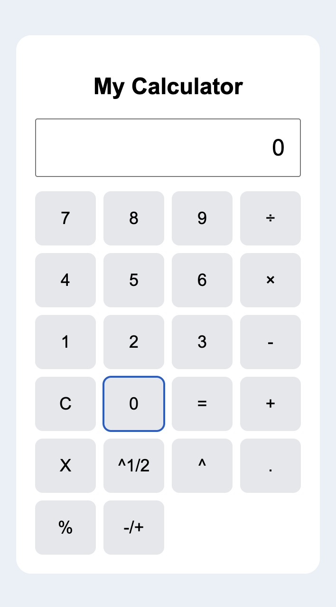

# 🧮 Calculator App

A simple and interactive calculator built using **HTML, CSS, and JavaScript**. This project was created to practice frontend web development and build a functional application with a clean user interface.

## ✨ Features

- ➕ Addition
- ➖ Subtraction
- ✖️ Multiplication
- ➗ Division
- 🎨 Clean and user-friendly interface
- ⚡ Instant calculations
- 📱 Responsive design (if supported)

## 🛠️ Tech Stack

- **HTML5** — Structure of the application
- **CSS3** — Styling and layout
- **JavaScript** — Calculation logic and interactivity

## 🚀 Getting Started

### Run Online
LINK - https://my-calculator-five-blush.vercel.app/

### Run Locally

1. Clone this repository:

   ```bash
   git clone https://github.com/raj-x3/my-calculator
   ```


2. Open `index.html` in your browser.

   Alternatively, use the Live Server extension in VS Code for a convenient development experience.

## 📸 Screenshot





## 📚 What I Learned

- Structuring web pages using HTML.
- Styling layouts and calculator buttons using CSS.
- Implementing arithmetic operations and event handling with JavaScript.
- Connecting HTML, CSS, and JavaScript to build an interactive application.
- Using Git and GitHub for version control and project sharing.

## 🔮 Future Improvements

- Add keyboard support.
- Improve the UI and animations.
- Handle invalid inputs and division by zero.
- Add calculation history.
- Improve responsiveness across devices.

## 👨‍💻 Author - Dipanshu Raj

Built with deepheart while learning frontend development.

